# TradeDesk

A free-data day-trading dashboard for **Windows** and **Android**: moving tickers and sectors, multi-timeframe charts with technical overlays, live news and X posts, yields, a heatmap, earnings, an economic calendar, halts, crowd mood and a plain-English market summary. Dark and light themes.

> **Code download is restricted for now.**
>
> **Not financial advice.** See the [disclaimer](#disclaimer).

## What it does

- **Home page:** the whole market on one screen: summary, bullish and bearish options flow, yields, calendar, earnings, commodities, sectors, crowd mood and headlines.
- **Ticker page:** click any ticker for its Chart, Options, News and Summary tabs.
- **Options flow:** a market-wide scan of large option trades, estimated as bullish or bearish.
- **Movers:** Gainers, Losers, Active (ranked by dollar volume), Halts, Gaps and Sectors, with filters and a sort control.
- **Charts:** 1m / 5m / 15m / 1h / 1D, crosshair details, moving averages and VWAP you can switch on and off, extended-hours candles, 1/2/4 chart layouts.
- **Technicals:** a plain-English readout, crossover signals, support/resistance, trend channel, expected-range fan, and day levels (prior-day, pre-market and opening-range highs and lows).
- **Summary:** a rule-based "what is happening" digest across stocks, rates, energy, volatility, earnings and the latest headlines.
- **Options:** the expected move the options market is pricing, put/call ratio, put skew, unusual flow and large trades, plus an expected-move overlay on the chart.
- **Heatmap, Bonds and yields, Earnings, Calendar, Sentiment** views.
- **News and X posts** from handles you choose.
- **Alerts** for yields, X posts, cross-asset moves, calendar releases and trading halts, with snooze, quiet hours and saved history.
- **Data health** panel showing which feeds are working.
- **Android** version with a phone layout and notifications.
- Built on free data sources only.

## Screenshots

### Windows
| | |
|---|---|
| 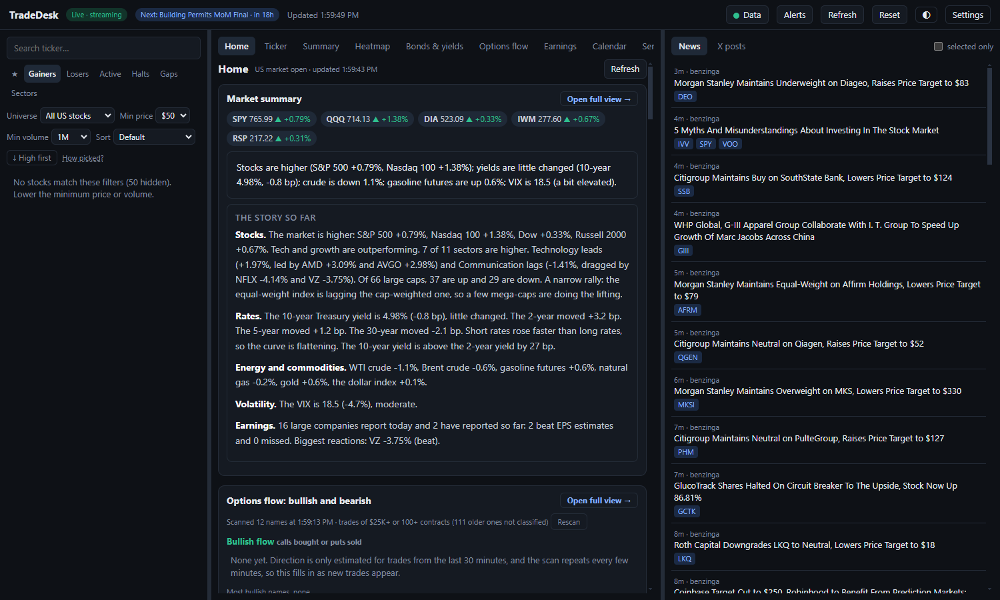   Home: the whole market on one page | 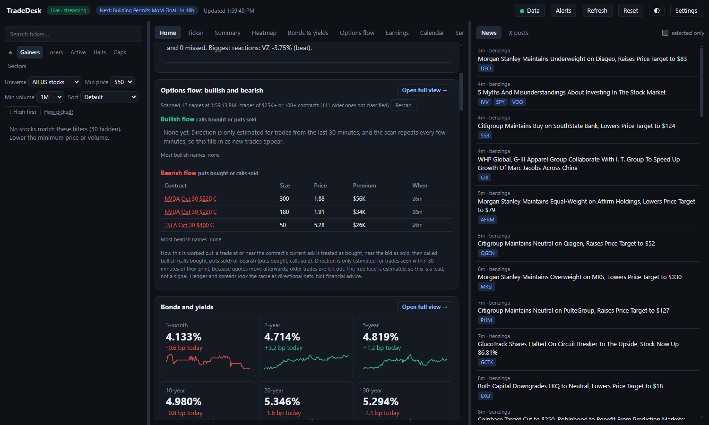   Home: bullish and bearish options flow |
| 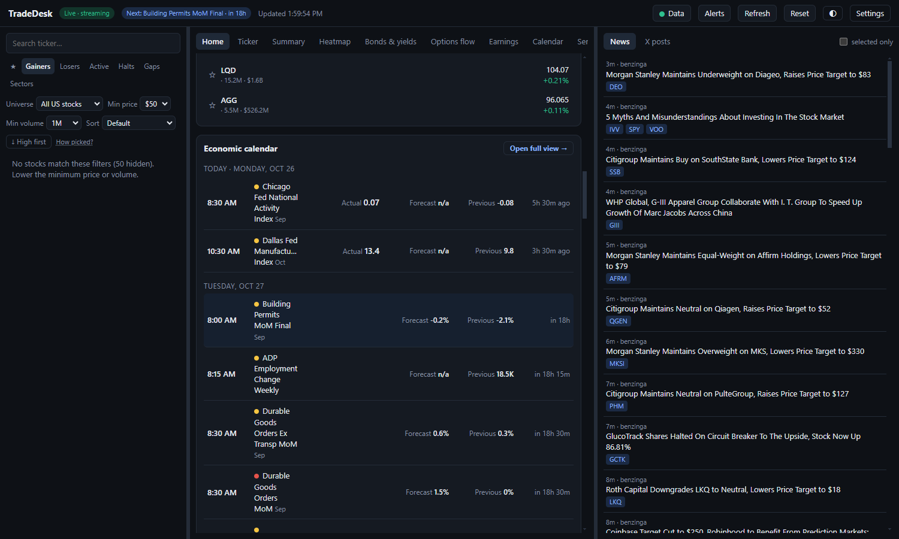   Home: calendar and earnings | 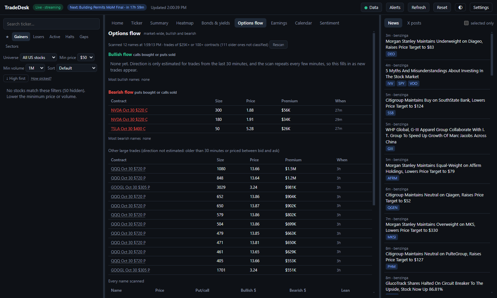   Options flow, market-wide |
| 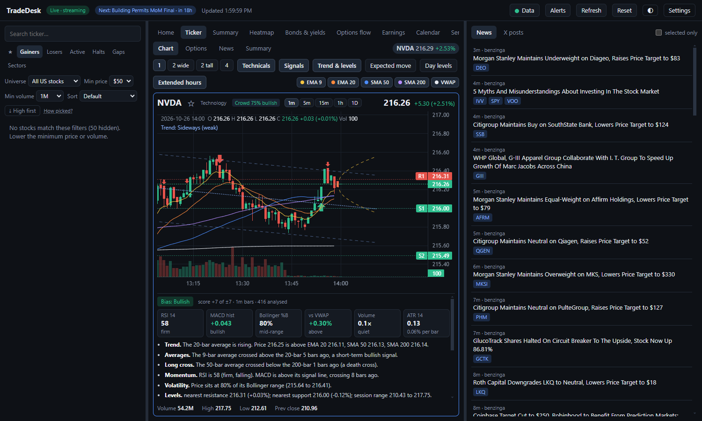   Ticker page: Chart | 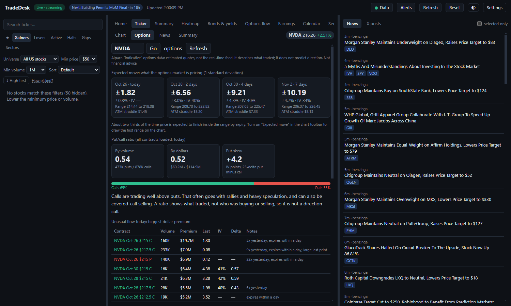   Ticker page: Options |
| 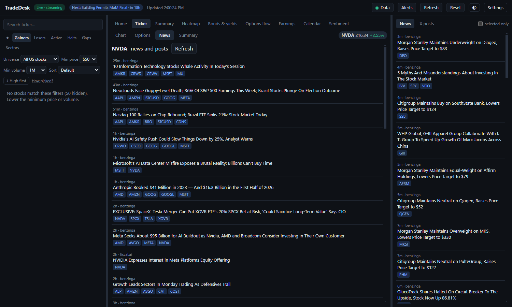   Ticker page: News | 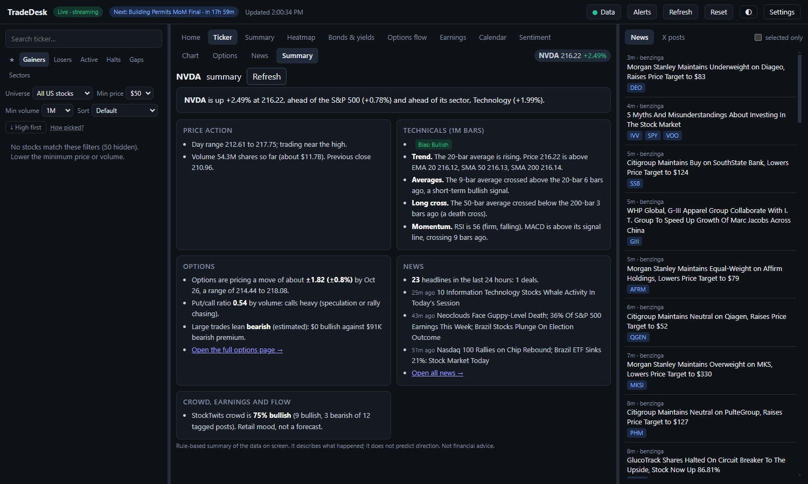   Ticker page: Summary |
| 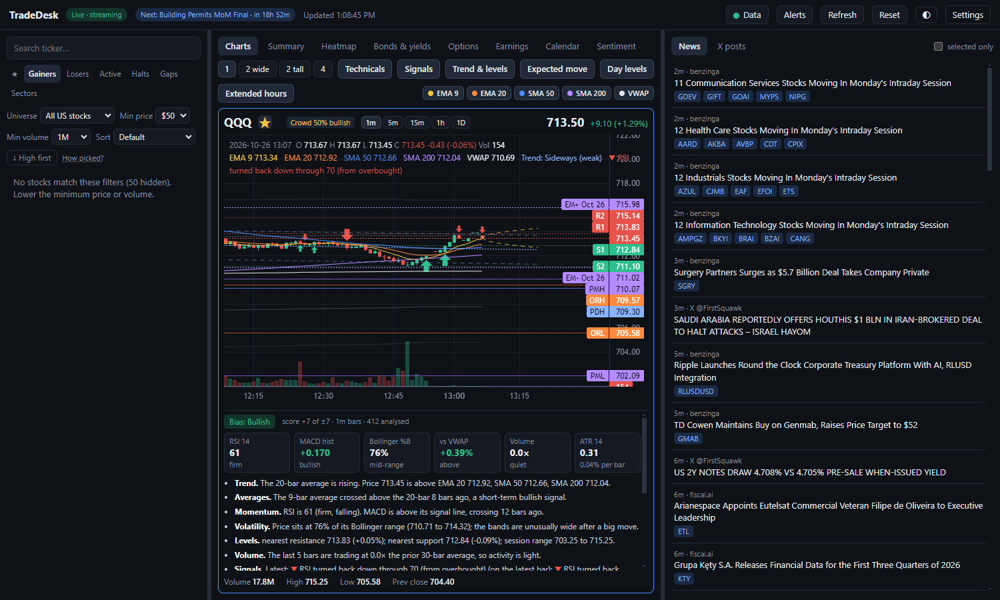   Expected-move lines on the chart |    Two charts side by side |
|    Active movers with sort and filters |    Market summary |
|    Heatmap |    Bonds and yields |
|    Earnings |    Economic calendar |
|    Crowd mood |    Alert history |
|    Data health |    Light theme |

### Android
| | | | |
|---|---|---|---|
| 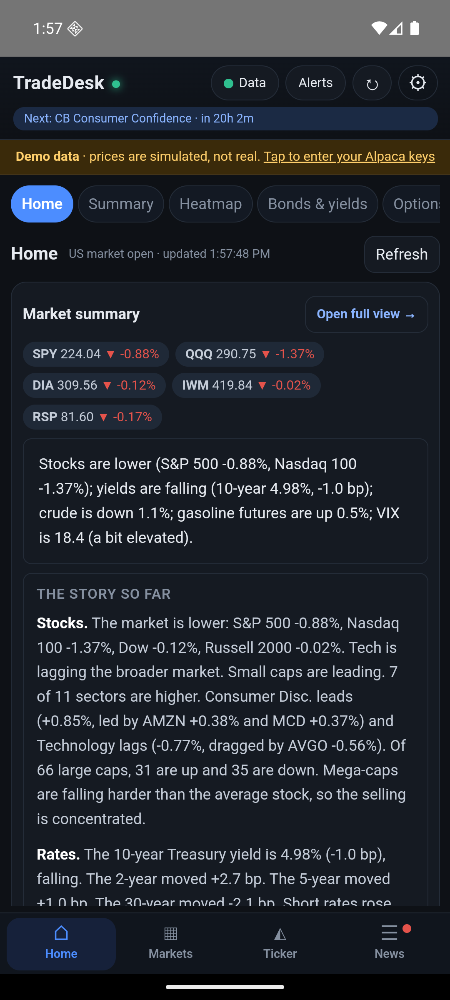 | 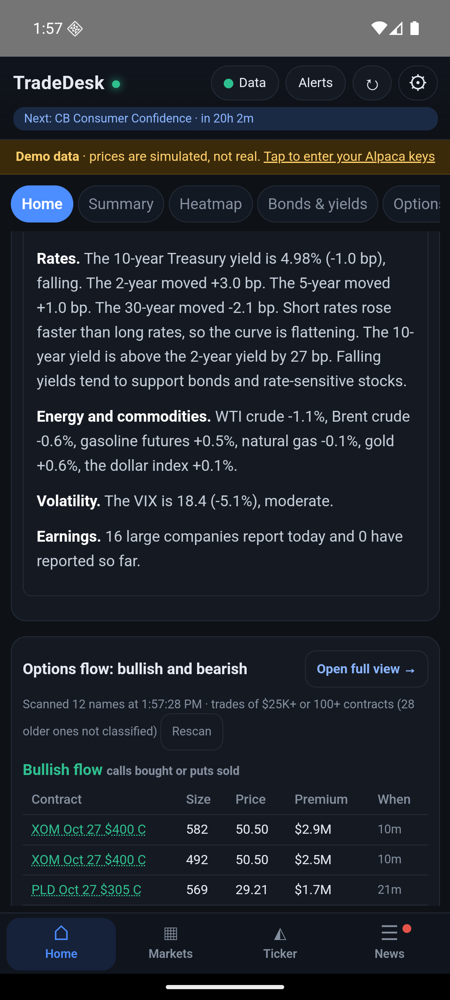 | 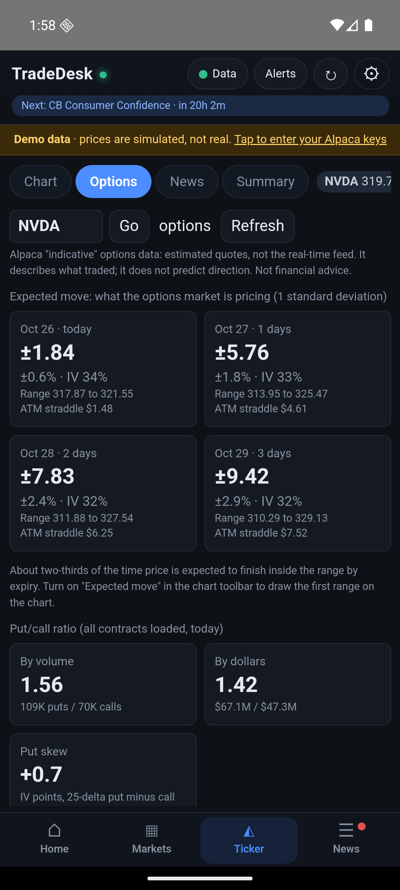 | 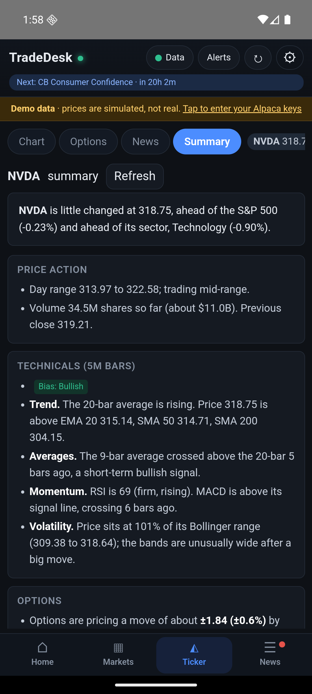 |
| Home | Home: options flow | Ticker: Options | Ticker: Summary |
|  |  |  |  |
| Charts | Markets | Yields | Light theme |

*Android screenshots use the built-in **simulated** demo data (shown in the yellow banner), so their prices are not real.*
## Disclaimer

- **Not financial advice.** TradeDesk is a personal data viewer. Nothing in it or in these screenshots is a recommendation to buy or sell anything. Signals, the summary and the options figures apply fixed rules to past or estimated data and are often wrong. Options data is an estimated feed. Trading, and options in particular, can lose money quickly.
- **Data and alerts are not guaranteed.** Prices, news and indicators can be late, wrong or missing. Alerts can fail or arrive late. The screenshots show data from a single moment and may be inaccurate.
- **Third parties.** Not affiliated with or endorsed by Alpaca, X, Yahoo, CNBC, TradingView, Nasdaq, StockTwits, Benzinga or any other provider. Their names and trademarks belong to their owners. Some feeds are unofficial and may break or be blocked. Reading X may conflict with X's terms.
- **No warranty or liability.** Everything here is provided as is. To the fullest extent permitted by law, the author is not liable for any loss arising from this page or the software it shows.
- **Charts** use [Lightweight Charts](https://github.com/tradingview/lightweight-charts) by TradingView, Inc. (Apache-2.0), copyright © TradingView, Inc. — https://www.tradingview.com/

## License

© 2026. All rights reserved. The software is not currently distributed.
